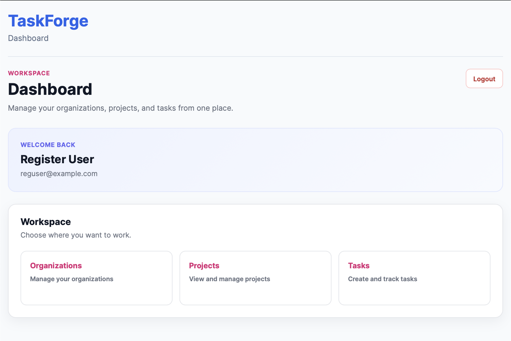
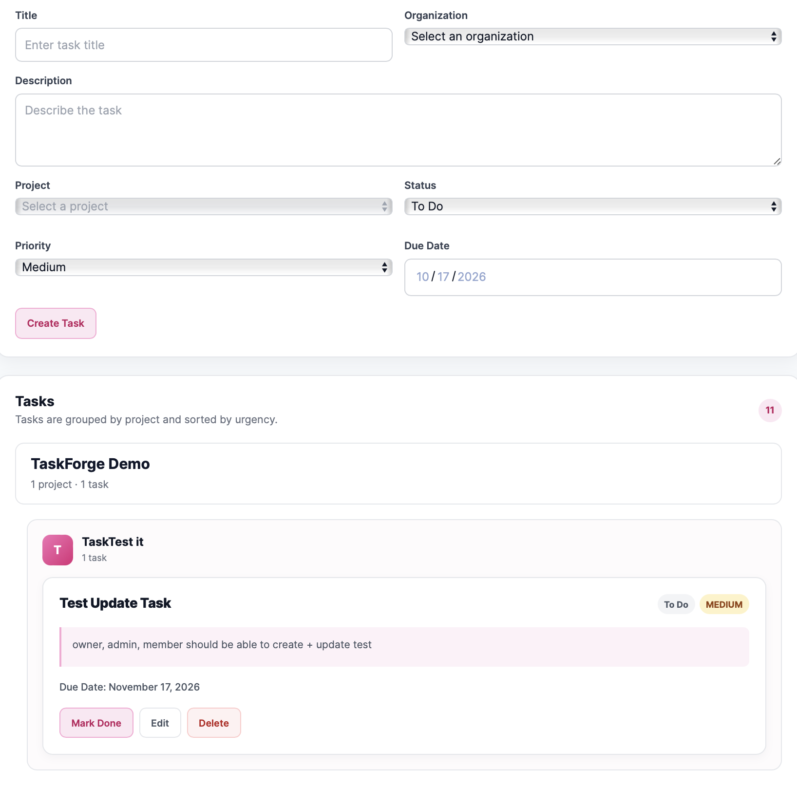
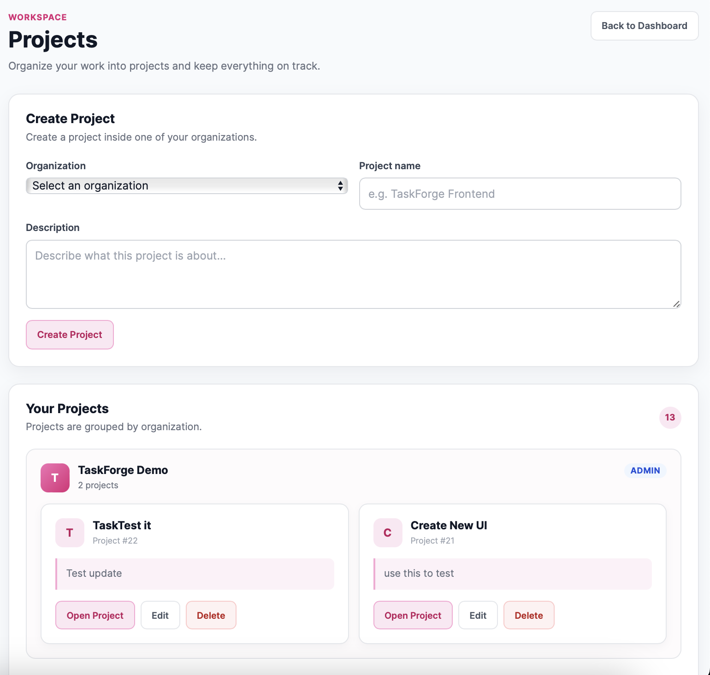
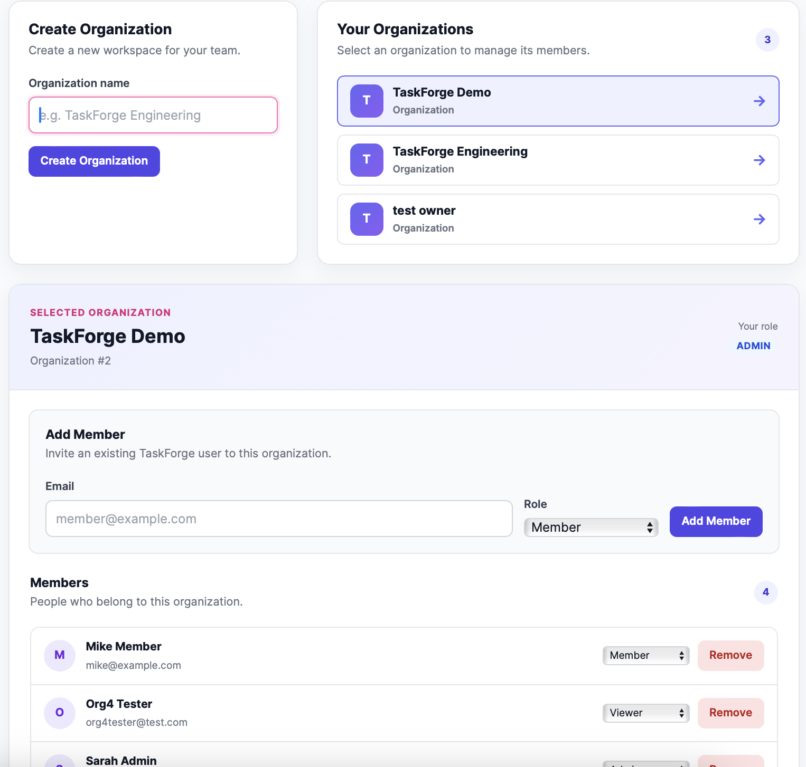
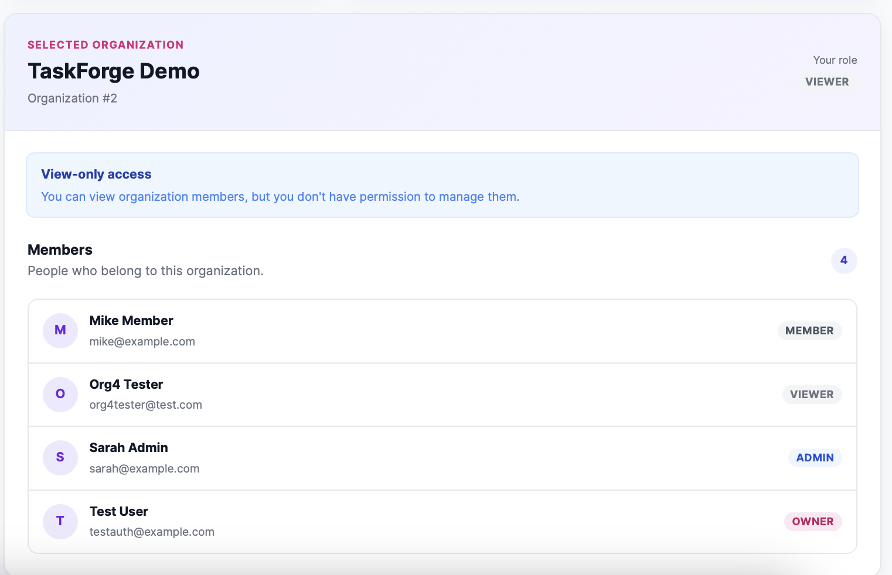

# TaskForge — Full-Stack SaaS Project Management Platform

A full-stack project management application built with React, TypeScript, Node.js, and Express. TaskForge enables teams to organize work through organizations, role-based memberships, projects, and tasks, with JWT authentication and organization-scoped authorization.

**Tech Stack:** React · TypeScript · Node.js · Express · REST API · JWT



---
## Overview

TaskForge is a multi-tenant project management application where users can create organizations, manage team members and roles, organize projects, and track tasks from creation to completion.

The application follows a layered backend architecture that separates HTTP routing, request validation, business logic, and database access. Organization membership and roles determine which resources users can access and which operations they can perform.

The frontend and backend currently run locally. Screenshots are included to provide a visual walkthrough without requiring a hosted demo.

## Key Features

- **JWT Authentication:** User registration, login, authenticated user retrieval, and token-based API authentication.
- **Multi-Tenant Organizations:** Create and manage organizations with organization-scoped memberships.
- **Role-Based Access Control:** OWNER, ADMIN, MEMBER, and VIEWER roles with role-aware UI controls and backend authorization.
- **Project Management:** Create, view, update, and delete projects within organizations.
- **Task Management:** Create, edit, complete, and delete tasks.
- **Task Properties:** Manage descriptions, assignees, status, priority, and due dates.
- **Task Organization:** Group tasks by project and prioritize incomplete tasks, deadlines, and priority levels.
- **REST API Integration:** Centralized frontend API services for communicating with the Express backend.
- **Layered Backend Architecture:** Separate routes, middleware, validation, services, repositories, and error handling.

---

## Screenshots

### Task Management Dashboard


Manage tasks, track deadlines, update priorities, and organize work across projects.

### Task Details and Management



TaskForge provides task management capabilities that allow users to:

- Create and edit tasks within selected organizations and projects.
- Set task status: TODO, IN_PROGRESS, and DONE.
- Assign priority levels: LOW, MEDIUM, and HIGH.
- Add task descriptions and due dates.
- Assign tasks to users where supported.
- Track completion and organize tasks by project.
- Prioritize incomplete tasks based on due dates and priority levels.

The task interface integrates with the REST API to create, retrieve, update, and delete tasks while respecting organization membership and role-based permissions.

### Project Management



Organize projects within organizations and manage project information.

### Organization and Team Management



Manage organization membership and assign organization-specific roles.

### Role-Based Access Control



The interface adapts to the current user's permissions. Backend authorization independently enforces access restrictions rather than relying exclusively on frontend controls.

---

## Technology Stack

| Layer | Technologies |
|---|---|
| Frontend | React, TypeScript |
| Backend | Node.js, Express, TypeScript |
| API | REST, JSON, HTTP |
| Authentication | JSON Web Tokens (JWT), Bearer authentication |
| Validation | Schema-based request validation |
| Architecture | Routes, middleware, services, repositories |
| Error Handling | Application errors and HTTP status codes |

---

## Application Architecture

TaskForge follows a layered client-server architecture that separates frontend responsibilities from backend business logic and database operations.

```text
React + TypeScript Frontend
            |
            v
      Frontend API Layer
            |
            v
       REST API (Express)
            |
            v
 Authentication Middleware
            |
            v
     Request Validation
            |
            v
      Service Layer
  Business Logic & Authorization
            |
            v
      Repository Layer
            |
            v
          Database
````

### Multi-Tenant Data Model

```text
User
 |
 v
Organization Membership
(Organization-Specific Role)
 |
 v
Organization
 |
 v
Projects
 |
 v
Tasks
```

A user's role belongs to their membership in a particular organization rather than being a single global role.

For example, a user can be an OWNER in one organization and a MEMBER or VIEWER in another.

## Authentication and Authorization

TaskForge uses JWT-based authentication to identify users making authenticated API requests.

- Users register and log in through the authentication API.
- Authenticated requests include a JWT in the `Authorization: Bearer <token>` header.
- Organization membership determines access to organization-scoped resources.
- Organization roles determine which operations are permitted.
- Backend services enforce business rules and authorization before protected operations are performed.
- Request validation rejects malformed or invalid input.
- Application errors use appropriate HTTP status codes.

### Organization Roles

| Role | Intended Access |
| --- | --- |
| OWNER | Organization ownership and administrative control |
| ADMIN | Organization administration and permitted management operations |
| MEMBER | Project and task operations permitted by application rules |
| VIEWER | Read-only access |

Actual permissions are determined by the backend authorization rules.

> Security principle: Frontend role checks improve the user experience; backend authorization is the actual security boundary.

## API Overview

The backend exposes REST endpoints for the main application resources.

| Resource | Example Endpoints |
| --- | --- |
| Authentication | `POST /api/auth/register`, `POST /api/auth/login`, `GET /api/auth/me` |
| Organizations | `GET /api/organizations`, `POST /api/organizations`, `DELETE /api/organizations/:organizationId` |
| Organization Members | `GET /api/organizations/:organizationId/members`, `POST /api/organizations/:organizationId/members` |
| Projects | `GET /api/projects`, `POST /api/projects`, `PATCH /api/projects/:id`, `DELETE /api/projects/:id` |
| Tasks | `GET /api/tasks`, `POST /api/tasks`, `PATCH /api/tasks/:id`, `DELETE /api/tasks/:id` |

Authenticated endpoints use Bearer token authentication where required.

## Engineering Highlights

### 1. Multi-Tenant Application Design

Structured the application around organizations, memberships, projects, and tasks to support organization-scoped resource access.

### 2. Role-Based Access Control

Implemented organization-specific roles and role-aware frontend controls, with backend authorization responsible for enforcing protected operations.

### 3. Layered Backend Architecture

Separated HTTP routes, authentication middleware, request validation, business logic, and database access to improve maintainability.

### 4. Centralized API Communication

Created a frontend API service layer to centralize HTTP requests, authentication headers, and API error handling.

### 5. Task Prioritization

Organized tasks by completion status, due dates, and priority to make outstanding and urgent work easier to identify.

### 6. Structured Error Handling

Used application-level errors and appropriate HTTP status codes to distinguish validation failures, authentication errors, authorization failures, missing resources, and unexpected server errors.

## Running Locally

TaskForge currently runs locally and does not yet have a hosted demo.

### Prerequisites

- Node.js
- npm
- The database required by the application
- Environment variables configured for the backend and frontend

### Backend Setup

Navigate to the backend directory:

```bash
cd server
npm install
```

Configure the required backend environment variables, then run the appropriate development script defined in `server/package.json`.

The backend API is configured to run at:

```text
http://localhost:5050
```

### Frontend Setup

Navigate to the frontend directory and install dependencies:

```bash
npm install
```

Configure the frontend API base URL:

```text
http://localhost:5050/api
```

Start the frontend using the appropriate development script defined in the frontend `package.json`.

## Testing and Verification

Important areas to verify during development include:

- Authentication and protected routes
- Organization membership and resource isolation
- Role-specific frontend controls
- Backend authorization for restricted API operations
- Project and task CRUD operations
- Request validation and error handling
- Loading states and empty states
- Authentication persistence and logout behavior

Frontend visibility checks alone are not sufficient to verify authorization. Restricted operations should also be tested directly against the backend API.

## Future Improvements

Potential next steps include:

- Task comments and activity history
- Email invitations and password reset
- Advanced search, filtering, and pagination
- Kanban boards and project dashboards
- File attachments and task labels
- Automated tests for authorization and organization isolation
- Deployment and production configuration
- Notifications and real-time updates

## Project Status

TaskForge is an actively developed full-stack SaaS-style application. The frontend and backend currently run locally, and screenshots provide a visual overview of the application's functionality.

## Why TaskForge?

TaskForge brings together frontend development, REST API integration, authentication, multi-tenant data modeling, role-based authorization, validation, error handling, and layered backend design in one application.

The project demonstrates an emphasis on maintainable code, clear separation of responsibilities, secure resource access, and practical user workflows.

Built with: React · TypeScript · Node.js · Express · REST API · JWT
